<div class='meta'>
<b>Name:</b> Vedant Nimkar &nbsp;|&nbsp; <b>Registration No.:</b> 26MML0045 &nbsp;|&nbsp; <b>Subject:</b> Visual Analytics Lab (MACSE603)<br>
<b>Assessment 1 covers:</b> environment setup and data-source connection, data cleansing and transformation, and data-model design.
</div>

## Aim

1. Set up the environment and connect to a data source — install Power BI Desktop, connect to SQL Server, load and preview the data.
2. Apply data cleansing and transformation in Power BI, loading the resulting queries into the data model using a sales dataset.
3. Design a data model — create model relationships, configure table and column properties, and create hierarchies using the sales dataset.

## Software Requirements

| Component | Purpose |
|---|---|
| Power BI Desktop | modelling, transformation and reporting |
| SQL Server + SSMS | relational data source |
| Power Query (M) | data cleansing and transformation |
| Python (pandas) | independent verification of results |

## Dataset Description

A retail sales dataset in star-schema layout. The fact table was deliberately produced in an uncleansed state so that the transformation requirements operate on genuine data-quality defects rather than on already-clean data.

| Table | Rows | Role |
|---|---|---|
| `FactSales_RAW` | 6,012 | Fact — order lines, uncleansed |
| `DimProduct` | 22 | Product, subcategory, category, pricing |
| `DimCustomer` | 220 | Customer name, segment, territory |
| `DimTerritory` | 5 | Region, country, group |
| `DimDate` | 1,096 | Calendar 2023-01-01 to 2025-12-31 |

Source files: `data/*.csv`, `data/SalesData.xlsx`, and `sql/01_create_load.sql` to recreate the tables in SQL Server.

---

# Step 1 — Setting Up the Environment and Connecting to the Data Source

## Procedure

1. Install **Power BI Desktop** and **SQL Server** with SQL Server Management Studio.
2. Open `sql/01_create_load.sql` in SSMS and execute it. This creates the `VisualAnalyticsLab` database and populates all five tables.
3. In Power BI Desktop select **Home → Get data → SQL Server**.
4. Enter the connection details:

| Field | Value |
|---|---|
| Server | `localhost` or `.\SQLEXPRESS` |
| Database | `VisualAnalyticsLab` |
| Data connectivity mode | Import |

5. In the **Navigator**, tick `FactSales`, `DimProduct`, `DimCustomer`, `DimTerritory` and `DimDate`, previewing each in the right-hand pane.
6. Click **Transform Data** rather than **Load**, so the data opens directly in Power Query Editor for cleansing.

> **CSV alternative.** If SQL Server is unavailable, use **Get data → Text/CSV** on the files in `data/`, or **Excel workbook** on `SalesData.xlsx`. Every later step is identical; only the `Source` line of each M query changes.

### M query for the SQL Server connection

```
let
    Source = Sql.Database("localhost", "VisualAnalyticsLab"),
    dbo_FactSales = Source{[Schema = "dbo", Item = "FactSales"]}[Data]
in
    dbo_FactSales
```


<figure class="sc">
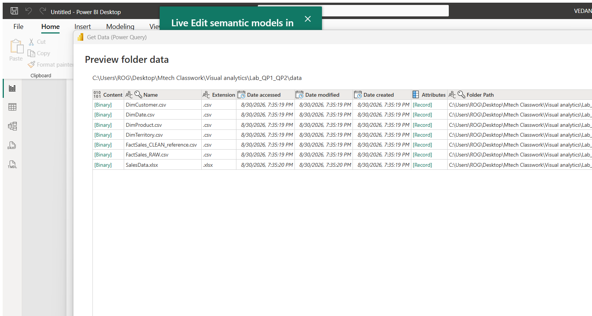
<figcaption><b>Screenshot 1.</b> Get data dialog with SQL Server selected</figcaption>
</figure>


<figure class="sc">
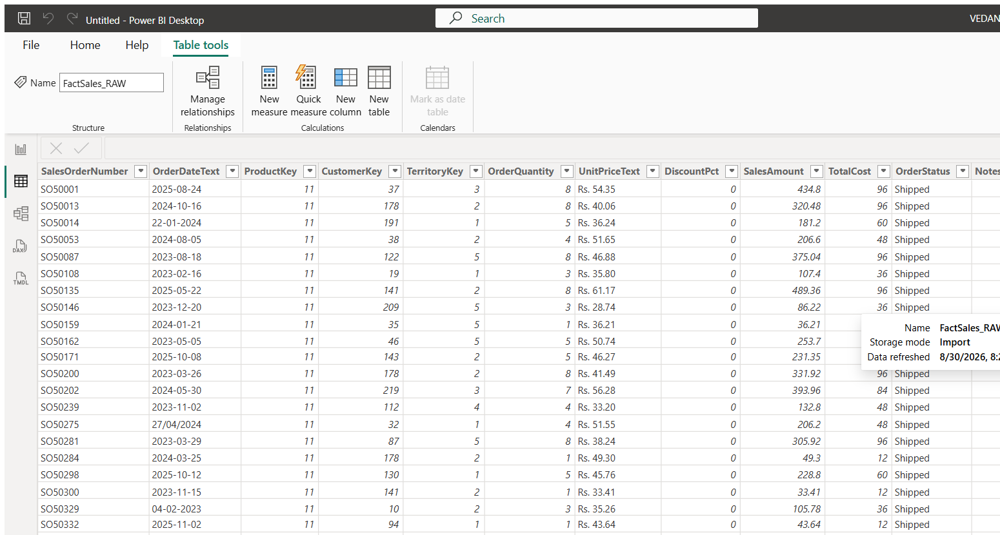
<figcaption><b>Screenshot 2.</b> Navigator window listing the five source tables with a live preview</figcaption>
</figure>


## Observation — data as loaded


<figure>
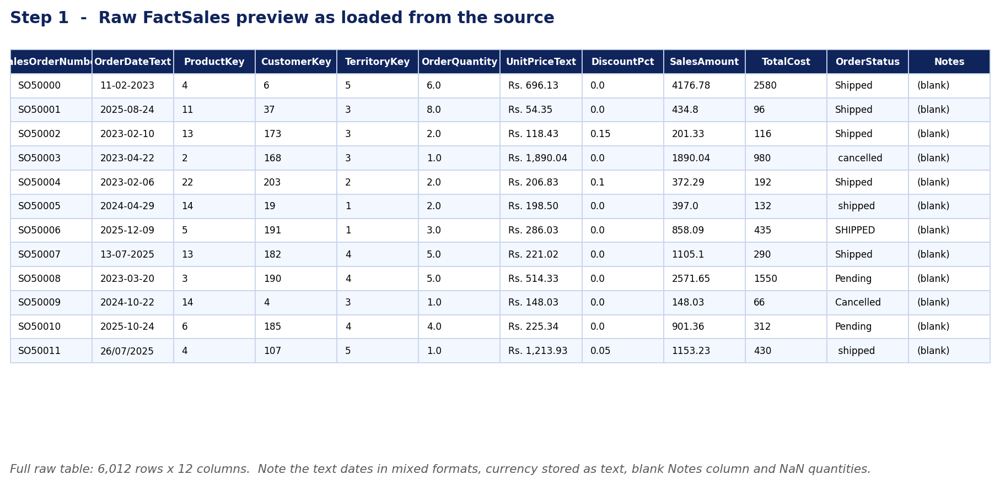
<figcaption><b>Figure 1.</b> Raw <code>FactSales</code> as loaded from the source. Dates arrive as text in three different formats, unit price is text carrying a currency prefix and thousands separators, <code>Notes</code> is entirely blank, and several quantities are missing.</figcaption>
</figure>


<figure class="sc">
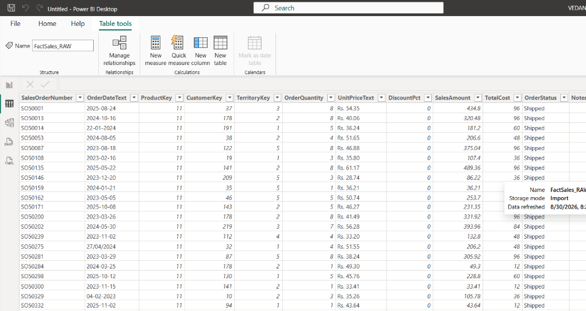
<figcaption><b>Screenshot 3.</b> Raw FactSales preview in Power BI before any transformation</figcaption>
</figure>


---

# Step 2 — Data Cleansing and Transformation

## Data-quality defects identified

| Defect | Occurrences | Treatment applied |
|---|---|---|
| Exact duplicate rows | 12 | `Table.Distinct` |
| Null `OrderQuantity` | 40 | rows removed |
| Null `SalesAmount` | 35 | recomputed as price × qty × (1 − discount) |
| Negative `OrderQuantity` | 8 | rows removed as data-entry errors |
| Blank `Notes` column | 1 column | column removed |
| Mixed date formats | 3 formats | parsed into a true `date` type |
| Currency stored as text | all rows | `"Rs. 1,234.00"` → `1234.00` |
| Untrimmed, inconsistent status text | many | `Text.Proper(Text.Trim())` |
| Cancelled orders | 949 | excluded from sales analysis |


<figure>
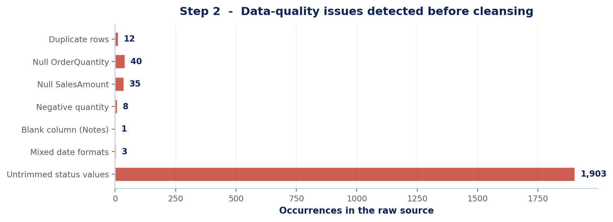
<figcaption><b>Figure 2.</b> Data-quality issues detected in the raw source, counted directly from the loaded data.</figcaption>
</figure>


## Applied steps and resulting row count

| # | Applied step | Rows remaining |
|---|---|---|
| 0 | Source loaded | 6,012 |
| 1 | Removed blank `Notes` column | 6,012 |
| 2 | Removed duplicates | 6,010 |
| 3 | Removed null quantity | 5,970 |
| 4 | Removed negative quantity | 5,962 |
| 5 | Excluded cancelled orders | **5,013** |


<figure>
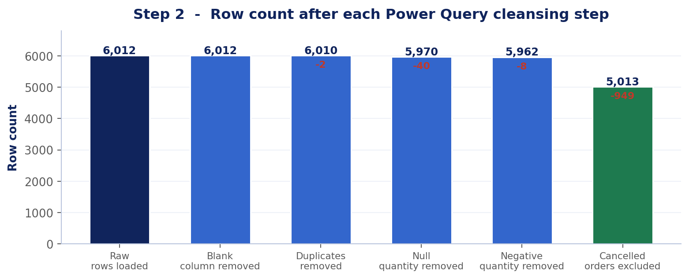
<figcaption><b>Figure 3.</b> Row count after each applied step. 6,012 raw rows reduce to 5,013 analysable rows, a 16.6% reduction attributable entirely to data-quality defects.</figcaption>
</figure>


## Power Query M — FactSales cleansing query

Paste into **Home → Transform data → Advanced Editor**, replacing `<PATH>` with the `data` folder path.

```
let
    // 1. CONNECT ------------------------------------------------------------
    Source = Csv.Document(
        File.Contents("<PATH>\FactSales_RAW.csv"),
        [Delimiter = ",", Encoding = 65001, QuoteStyle = QuoteStyle.Csv]),
    Promoted = Table.PromoteHeaders(Source, [PromoteAllScalars = true]),

    // 2. REMOVE the always-blank column -------------------------------------
    RemovedBlankCol = Table.RemoveColumns(Promoted, {"Notes"}),

    // 3. REMOVE duplicate rows ----------------------------------------------
    RemovedDuplicates = Table.Distinct(RemovedBlankCol),

    // 4. PARSE the mixed-format text date into a real date -------------------
    //    Source has yyyy-MM-dd, dd-MM-yyyy and dd/MM/yyyy mixed together.
    AddedOrderDate = Table.AddColumn(RemovedDuplicates, "OrderDate",
        each let t = Text.Replace([OrderDateText], "/", "-"),
                 p = Text.Split(t, "-")
             in  if Text.Length(p{0}) = 4
                 then #date(Number.FromText(p{0}), Number.FromText(p{1}),
                            Number.FromText(p{2}))
                 else #date(Number.FromText(p{2}), Number.FromText(p{1}),
                            Number.FromText(p{0})),
        type date),

    // 5. STRIP the currency text into a decimal ------------------------------
    AddedUnitPrice = Table.AddColumn(AddedOrderDate, "UnitPrice",
        each Number.FromText(
            Text.Trim(Text.Replace(Text.Replace([UnitPriceText], "Rs.", ""),
                                   ",", ""))),
        type number),

    // 6. CLEAN the messy status text (trim + consistent casing) --------------
    CleanedStatus = Table.TransformColumns(AddedUnitPrice,
        {{"OrderStatus", each Text.Proper(Text.Trim(_)), type text}}),

    // 7. SET data types ------------------------------------------------------
    Typed = Table.TransformColumnTypes(CleanedStatus, {
        {"SalesOrderNumber", type text},
        {"ProductKey", Int64.Type},
        {"CustomerKey", Int64.Type},
        {"TerritoryKey", Int64.Type},
        {"OrderQuantity", Int64.Type},
        {"DiscountPct", type number},
        {"SalesAmount", type number},
        {"TotalCost", type number}}),

    // 8. REMOVE rows with a missing quantity ---------------------------------
    RemovedNullQty = Table.SelectRows(Typed,
        each [OrderQuantity] <> null),

    // 9. REMOVE negative-quantity data-entry errors --------------------------
    RemovedNegative = Table.SelectRows(RemovedNullQty,
        each [OrderQuantity] > 0),

    // 10. FILL the missing SalesAmount from price x qty x (1 - discount) -----
    FixedSalesAmount = Table.ReplaceValue(RemovedNegative,
        each [SalesAmount],
        each if [SalesAmount] = null
             then Number.Round([UnitPrice] * [OrderQuantity]
                               * (1 - [DiscountPct]), 2)
             else [SalesAmount],
        Replacer.ReplaceValue, {"SalesAmount"}),

    // 11. EXCLUDE cancelled orders from the sales analysis --------------------
    RemovedCancelled = Table.SelectRows(FixedSalesAmount,
        each [OrderStatus] <> "Cancelled"),

    // 12. ADD a Profit column ------------------------------------------------
    AddedProfit = Table.AddColumn(RemovedCancelled, "Profit",
        each [SalesAmount] - [TotalCost], type number),

    // 13. ADD the DateKey used to join DimDate -------------------------------
    AddedDateKey = Table.AddColumn(AddedProfit, "DateKey",
        each Date.Year([OrderDate]) * 10000
           + Date.Month([OrderDate]) * 100
           + Date.Day([OrderDate]), Int64.Type),

    // 14. DROP the now-redundant raw text columns ----------------------------
    RemovedRawText = Table.RemoveColumns(AddedDateKey,
        {"OrderDateText", "UnitPriceText"}),

    // 15. REORDER for readability --------------------------------------------
    Reordered = Table.ReorderColumns(RemovedRawText, {
        "SalesOrderNumber", "OrderDate", "DateKey", "ProductKey",
        "CustomerKey", "TerritoryKey", "OrderQuantity", "UnitPrice",
        "DiscountPct", "SalesAmount", "TotalCost", "Profit", "OrderStatus"})
in
    Reordered
```

The dimension queries and the SQL Server variant are in `code/Step2_PowerQuery_M.txt`.


## Result of cleansing


<figure>
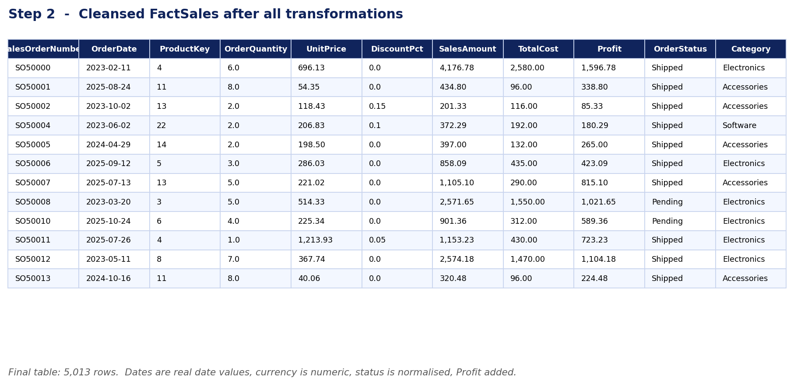
<figcaption><b>Figure 4.</b> Cleansed <code>FactSales</code>. Dates are real date values, currency is numeric, order status is normalised to two values, and a derived <code>Profit</code> column has been added.</figcaption>
</figure>


<div class='ok'><b>Verification.</b> The identical cleansing logic was replicated in pandas over the same source file, producing 5,013 rows and the distinct status values <code>Pending</code> and <code>Shipped</code>. See <code>expected_results/EXPECTED_RESULTS.txt</code>.</div>

---

# Step 3 — Designing the Data Model

## 3.1 Model relationships

Created in **Model view** by dragging each dimension key onto the matching column in `FactSales`.

| # | One side | Many side | Cardinality | Cross-filter | Active |
|---|---|---|---|---|---|
| 1 | `DimDate[DateKey]` | `FactSales[DateKey]` | 1:* | Single | Yes |
| 2 | `DimProduct[ProductKey]` | `FactSales[ProductKey]` | 1:* | Single | Yes |
| 3 | `DimCustomer[CustomerKey]` | `FactSales[CustomerKey]` | 1:* | Single | Yes |
| 4 | `DimTerritory[TerritoryKey]` | `FactSales[TerritoryKey]` | 1:* | Single | Yes |
| 5 | `DimTerritory[TerritoryKey]` | `DimCustomer[TerritoryKey]` | 1:* | Single | **No** |

Relationship 5 is deliberately left **inactive**. Both `FactSales` and `DimCustomer` carry `TerritoryKey`, which creates two routes to `DimTerritory`; Power BI permits only one active path between two tables. The direct fact relationship is kept active, and the inactive one is invoked on demand with `USERELATIONSHIP` in Assessment 2.

### Marking the date table

Select `DimDate` → **Table tools → Mark as date table** → choose the `Date` column. This is a prerequisite for the Time Intelligence functions used in Assessment 2; without it those functions return silently incorrect results.


<figure>
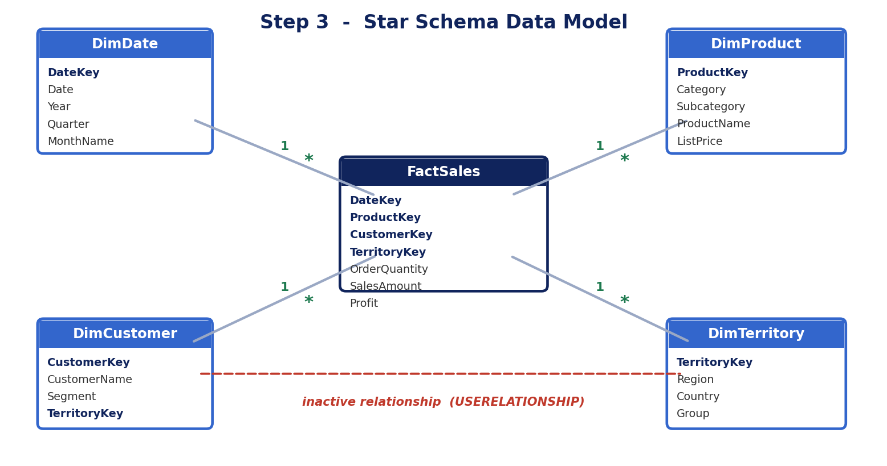
<figcaption><b>Figure 5.</b> Star schema: a single fact table surrounded by four conformed dimensions. The inactive Customer→Territory relationship is shown dashed.</figcaption>
</figure>


<figure class="sc">
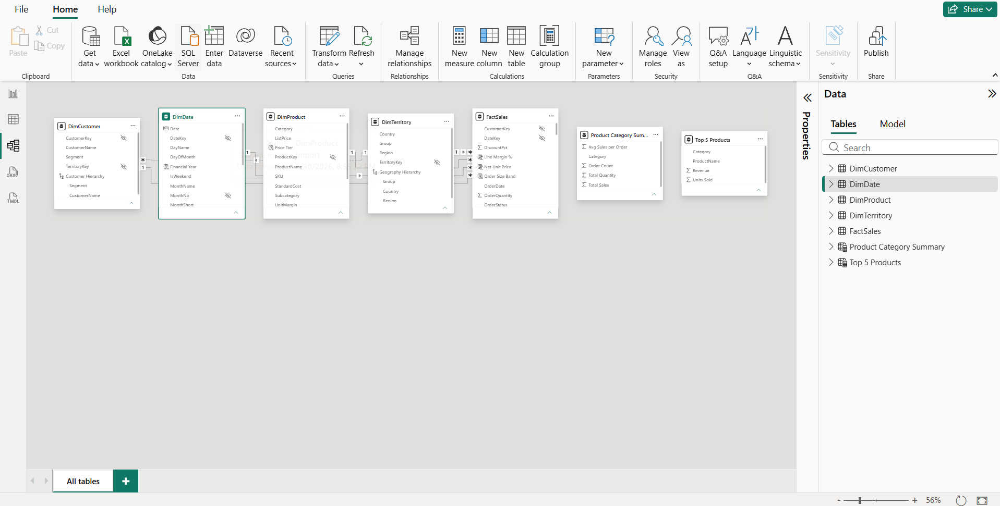
<figcaption><b>Screenshot 4.</b> Model view showing the completed star schema</figcaption>
</figure>


## 3.2 Table and column properties

### FactSales

| Column | Data type | Format | Summarisation | Hidden |
|---|---|---|---|---|
| `SalesOrderNumber` | Text | — | Do not summarize | No |
| `OrderDate` | Date | dd mmm yyyy | Do not summarize | No |
| `DateKey` | Whole number | — | Do not summarize | Yes |
| `ProductKey` | Whole number | — | Do not summarize | Yes |
| `CustomerKey` | Whole number | — | Do not summarize | Yes |
| `TerritoryKey` | Whole number | — | Do not summarize | Yes |
| `OrderQuantity` | Whole number | #,##0 | Sum | No |
| `UnitPrice` | Decimal | Currency 2 dp | Do not summarize | No |
| `DiscountPct` | Decimal | Percentage | Average | No |
| `SalesAmount` | Decimal | Currency 2 dp | Sum | No |
| `TotalCost` | Decimal | Currency 2 dp | Sum | No |
| `Profit` | Decimal | Currency 2 dp | Sum | No |
| `OrderStatus` | Text | — | Do not summarize | No |

Hiding the surrogate keys is the substantive point of this exercise: report authors are forced to use descriptive dimension attributes rather than meaningless integers, and the keys can no longer be accidentally aggregated.

### DimDate — sort-by-column settings

| Column | Sort by | Reason |
|---|---|---|
| `MonthName` | `MonthNo` | otherwise the axis reads April, August, December alphabetically |
| `MonthShort` | `MonthNo` | same |
| `Quarter` | `QuarterNo` | chronological quarter order |

### DimProduct / DimCustomer / DimTerritory

| Setting | Applied to |
|---|---|
| Hidden | `ProductKey`, `CustomerKey`, `TerritoryKey` |
| Currency 2 dp, Do not summarize | `StandardCost`, `ListPrice`, `UnitMargin` |
| Do not summarize | `Category`, `Subcategory`, `Segment`, `Region` |


<figure class="sc">
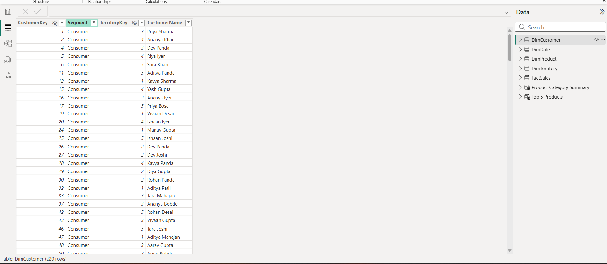
<figcaption><b>Screenshot 5.</b> Column properties pane showing format, summarisation and hidden settings</figcaption>
</figure>


## 3.3 Hierarchies

Created by right-clicking the top-level field → **Create hierarchy**, then dragging the remaining levels in order.

| Hierarchy | Levels |
|---|---|
| Product Hierarchy | Category → Subcategory → ProductName |
| Date Hierarchy | Year → Quarter → MonthName → DayOfMonth |
| Geography Hierarchy | Group → Country → Region |
| Customer Hierarchy | Segment → CustomerName |


<figure>
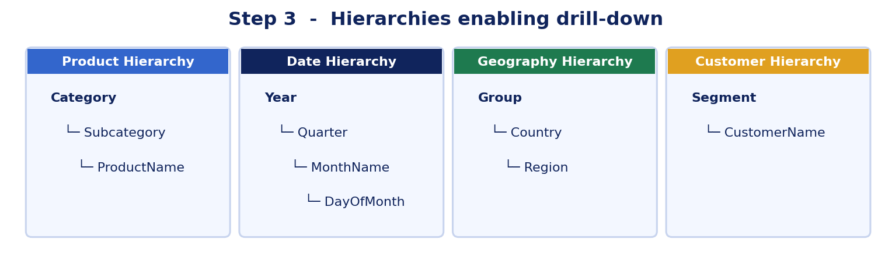
<figcaption><b>Figure 6.</b> The four hierarchies created to support drill-down in the report visuals.</figcaption>
</figure>


## 3.4 Verification checklist

| Check | Expected |
|---|---|
| Model shape | star, not snowflake |
| Active relationships | 4 |
| Inactive relationships | 1 |
| `DimDate` marked as date table | yes |
| Surrogate keys hidden | all `*Key` columns |
| `MonthName` axis order | chronological |
| Hierarchies drilling correctly | all four |

---

# Result

All three objectives of Assessment 1 were completed.

**Step 1.** The environment was configured and the sales dataset connected in Import mode, with all five tables previewed in the Navigator before being opened in Power Query Editor.

**Step 2.** Fifteen applied steps reduced 6,012 raw rows to 5,013 analysable rows. Twelve duplicates, 40 null quantities and 8 negative quantities were removed, 949 cancelled orders excluded, 35 missing sales amounts recomputed, three mixed date formats parsed into a single date type, text currency converted to numeric, and order status normalised.

**Step 3.** A star schema was built with four active relationships and one deliberately inactive relationship to avoid an ambiguous filter path. `DimDate` was marked as a date table, surrogate keys were hidden, formats and summarisation were configured, sort-by-column was applied so that month names order chronologically, and four hierarchies were created for drill-down.

The cleansing outcome was independently verified against a pandas reimplementation over the same source data.

## Deliverables

| Path | Contents |
|---|---|
| `data/` | CSV files and `SalesData.xlsx` |
| `sql/01_create_load.sql` | SQL Server DDL and data load |
| `code/Step2_PowerQuery_M.txt` | all five Power Query M queries |
| `code/Step3_DataModel.md` | relationships, properties, hierarchies |
| `expected_results/EXPECTED_RESULTS.txt` | verification values |
| `figures/` | figures reproduced in this record |
| `screenshots/` | Power BI Desktop captures |

---

# Appendix A — Complete Applied Power Query (M)

Extracted programmatically from the applied semantic model (`Visual1.SemanticModel/definition/tables/*.tmdl`). Each listing is the actual `partition = m` source executing on refresh, not a separately maintained transcription.

## DimCustomer

```
let
    Source = Csv.Document(File.Contents("C:\Users\ROG\Desktop\Mtech Classwork\Visual analytics\Lab_QP1_QP2\data\DimCustomer.csv"),
        [Delimiter = ",", Encoding = 65001, QuoteStyle = QuoteStyle.Csv]),
    Promoted = Table.PromoteHeaders(Source, [PromoteAllScalars = true]),
    Typed = Table.TransformColumnTypes(Promoted, {
        {"CustomerKey", Int64.Type}, {"Segment", type text},
        {"TerritoryKey", Int64.Type}, {"CustomerName", type text}})
in
    Typed
```

## DimDate

```
let
    Source = Csv.Document(File.Contents("C:\Users\ROG\Desktop\Mtech Classwork\Visual analytics\Lab_QP1_QP2\data\DimDate.csv"),
        [Delimiter = ",", Encoding = 65001, QuoteStyle = QuoteStyle.Csv]),
    Promoted = Table.PromoteHeaders(Source, [PromoteAllScalars = true]),
    Typed = Table.TransformColumnTypes(Promoted, {
        {"DateKey", Int64.Type}, {"Date", type date}, {"Year", Int64.Type},
        {"QuarterNo", Int64.Type}, {"Quarter", type text},
        {"MonthNo", Int64.Type}, {"MonthName", type text},
        {"MonthShort", type text}, {"YearMonth", type text},
        {"WeekOfYear", Int64.Type}, {"DayOfMonth", Int64.Type},
        {"DayName", type text}, {"IsWeekend", type logical}})
in
    Typed
```

## DimProduct

```
let
    Source = Csv.Document(File.Contents("C:\Users\ROG\Desktop\Mtech Classwork\Visual analytics\Lab_QP1_QP2\data\DimProduct.csv"),
        [Delimiter = ",", Encoding = 65001, QuoteStyle = QuoteStyle.Csv]),
    Promoted = Table.PromoteHeaders(Source, [PromoteAllScalars = true]),
    Typed = Table.TransformColumnTypes(Promoted, {
        {"ProductKey", Int64.Type}, {"Category", type text},
        {"Subcategory", type text}, {"ProductName", type text},
        {"StandardCost", type number}, {"ListPrice", type number},
        {"SKU", type text}}),
    Trimmed = Table.TransformColumns(Typed, {
        {"Category", Text.Trim, type text},
        {"Subcategory", Text.Trim, type text},
        {"ProductName", Text.Trim, type text}}),
    AddedMargin = Table.AddColumn(Trimmed, "UnitMargin",
        each [ListPrice] - [StandardCost], type number)
in
    AddedMargin
```

## DimTerritory

```
let
    Source = Csv.Document(File.Contents("C:\Users\ROG\Desktop\Mtech Classwork\Visual analytics\Lab_QP1_QP2\data\DimTerritory.csv"),
        [Delimiter = ",", Encoding = 65001, QuoteStyle = QuoteStyle.Csv]),
    Promoted = Table.PromoteHeaders(Source, [PromoteAllScalars = true]),
    Typed = Table.TransformColumnTypes(Promoted, {
        {"TerritoryKey", Int64.Type}, {"Region", type text},
        {"Country", type text}, {"Group", type text}})
in
    Typed
```

## FactSales

```
let
    // 1. CONNECT ------------------------------------------------------------
    Source = Csv.Document(
        File.Contents("C:\Users\ROG\Desktop\Mtech Classwork\Visual analytics\Lab_QP1_QP2\data\FactSales_RAW.csv"),
        [Delimiter = ",", Encoding = 65001, QuoteStyle = QuoteStyle.Csv]),
    Promoted = Table.PromoteHeaders(Source, [PromoteAllScalars = true]),

    // 2. REMOVE the always-blank column -------------------------------------
    RemovedBlankCol = Table.RemoveColumns(Promoted, {"Notes"}),

    // 3. REMOVE duplicate rows ----------------------------------------------
    RemovedDuplicates = Table.Distinct(RemovedBlankCol),

    // 4. PARSE the mixed-format text date into a real date -------------------
    //    Source has yyyy-MM-dd, dd-MM-yyyy and dd/MM/yyyy mixed together.
    AddedOrderDate = Table.AddColumn(RemovedDuplicates, "OrderDate",
        each let t = Text.Replace([OrderDateText], "/", "-"),
                 p = Text.Split(t, "-")
             in  if Text.Length(p{0}) = 4
                 then #date(Number.FromText(p{0}), Number.FromText(p{1}),
                            Number.FromText(p{2}))
                 else #date(Number.FromText(p{2}), Number.FromText(p{1}),
                            Number.FromText(p{0})),
        type date),

    // 5. STRIP the currency text into a decimal ------------------------------
    AddedUnitPrice = Table.AddColumn(AddedOrderDate, "UnitPrice",
        each Number.FromText(
            Text.Trim(Text.Replace(Text.Replace([UnitPriceText], "Rs.", ""),
                                   ",", ""))),
        type number),

    // 6. CLEAN the messy status text (trim + consistent casing) --------------
    CleanedStatus = Table.TransformColumns(AddedUnitPrice,
        {{"OrderStatus", each Text.Proper(Text.Trim(_)), type text}}),

    // 7. SET data types ------------------------------------------------------
    Typed = Table.TransformColumnTypes(CleanedStatus, {
        {"SalesOrderNumber", type text},
        {"ProductKey", Int64.Type},
        {"CustomerKey", Int64.Type},
        {"TerritoryKey", Int64.Type},
        {"OrderQuantity", Int64.Type},
        {"DiscountPct", type number},
        {"SalesAmount", type number},
        {"TotalCost", type number}}),

    // 8. REMOVE rows with a missing quantity ---------------------------------
    RemovedNullQty = Table.SelectRows(Typed,
        each [OrderQuantity] <> null),

    // 9. REMOVE negative-quantity data-entry errors --------------------------
    RemovedNegative = Table.SelectRows(RemovedNullQty,
        each [OrderQuantity] > 0),

    // 10. FILL the missing SalesAmount from price x qty x (1 - discount) -----
    FixedSalesAmount = Table.ReplaceValue(RemovedNegative,
        each [SalesAmount],
        each if [SalesAmount] = null
             then Number.Round([UnitPrice] * [OrderQuantity]
                               * (1 - [DiscountPct]), 2)
             else [SalesAmount],
        Replacer.ReplaceValue, {"SalesAmount"}),

    // 11. EXCLUDE cancelled orders from the sales analysis --------------------
    RemovedCancelled = Table.SelectRows(FixedSalesAmount,
        each [OrderStatus] <> "Cancelled"),

    // 12. ADD a Profit column ------------------------------------------------
    AddedProfit = Table.AddColumn(RemovedCancelled, "Profit",
        each [SalesAmount] - [TotalCost], type number),

    // 13. ADD the DateKey used to join DimDate -------------------------------
    AddedDateKey = Table.AddColumn(AddedProfit, "DateKey",
        each Date.Year([OrderDate]) * 10000
           + Date.Month([OrderDate]) * 100
           + Date.Day([OrderDate]), Int64.Type),

    // 14. DROP the now-redundant raw text columns ----------------------------
    RemovedRawText = Table.RemoveColumns(AddedDateKey,
        {"OrderDateText", "UnitPriceText"}),

    // 15. REORDER for readability --------------------------------------------
    Reordered = Table.ReorderColumns(RemovedRawText, {
        "SalesOrderNumber", "OrderDate", "DateKey", "ProductKey",
        "CustomerKey", "TerritoryKey", "OrderQuantity", "UnitPrice",
        "DiscountPct", "SalesAmount", "TotalCost", "Profit", "OrderStatus"})
in
    Reordered
```


---

# Appendix B — Applied Model Structure

Relationships, hierarchies and column properties as they exist in the applied model, confirming the Step 3 configuration.

## Relationships

| Name | From (many) | To (one) | Active |
|---|---|---|---|
| `rel_Date_Fact` | `FactSales.DateKey` | `DimDate.DateKey` | Yes |
| `rel_Product_Fact` | `FactSales.ProductKey` | `DimProduct.ProductKey` | Yes |
| `rel_Customer_Fact` | `FactSales.CustomerKey` | `DimCustomer.CustomerKey` | Yes |
| `rel_Territory_Fact` | `FactSales.TerritoryKey` | `DimTerritory.TerritoryKey` | Yes |
| `rel_Territory_Customer` | `DimCustomer.TerritoryKey` | `DimTerritory.TerritoryKey` | **No** |

5 relationships, 1 inactive.

## Date table

`DimDate` carries `dataCategory: Time`, confirming it is marked as the model date table. This is required for the Time Intelligence functions used in Assessment 2.

## Hierarchies

| Table | Hierarchy | Levels |
|---|---|---|
| `DimCustomer` | Customer Hierarchy | Segment → CustomerName |
| `DimDate` | Date Hierarchy | Year → Quarter → MonthName → DayOfMonth |
| `DimProduct` | Product Hierarchy | Category → Subcategory → ProductName |
| `DimTerritory` | Geography Hierarchy | Group → Country → Region |

## Column properties

Only the properties configured in Step 3 are listed: hidden surrogate keys, formatting, summarisation and sort-by-column.

### DimCustomer

| Column | Type | Format | Summarise | Hidden | Sort by |
|---|---|---|---|---|---|
| `CustomerKey` | int64 |  | none | Yes |  |
| `TerritoryKey` | int64 |  | none | Yes |  |

### DimDate

| Column | Type | Format | Summarise | Hidden | Sort by |
|---|---|---|---|---|---|
| `DateKey` | int64 |  | none | Yes |  |
| `Date` | dateTime | dd mmm yyyy | none |  |  |
| `QuarterNo` | int64 |  | none | Yes |  |
| `Quarter` | string |  | none |  | QuarterNo |
| `MonthNo` | int64 |  | none | Yes |  |
| `MonthName` | string |  | none |  | MonthNo |
| `MonthShort` | string |  | none |  | MonthNo |

### DimProduct

| Column | Type | Format | Summarise | Hidden | Sort by |
|---|---|---|---|---|---|
| `ProductKey` | int64 |  | none | Yes |  |
| `StandardCost` | double | \$#,0.00;(\$#,0.00);\$#,0.00 | none |  |  |
| `ListPrice` | double | \$#,0.00;(\$#,0.00);\$#,0.00 | none |  |  |
| `UnitMargin` | double | \$#,0.00;(\$#,0.00);\$#,0.00 | none |  |  |

### DimTerritory

| Column | Type | Format | Summarise | Hidden | Sort by |
|---|---|---|---|---|---|
| `TerritoryKey` | int64 |  | none | Yes |  |

### FactSales

| Column | Type | Format | Summarise | Hidden | Sort by |
|---|---|---|---|---|---|
| `OrderDate` | dateTime | dd mmm yyyy | none |  |  |
| `DateKey` | int64 |  | none | Yes |  |
| `ProductKey` | int64 |  | none | Yes |  |
| `CustomerKey` | int64 |  | none | Yes |  |
| `TerritoryKey` | int64 |  | none | Yes |  |
| `OrderQuantity` | int64 | #,0 | sum |  |  |
| `UnitPrice` | double | \$#,0.00;(\$#,0.00);\$#,0.00 | none |  |  |
| `DiscountPct` | double | 0.00% | average |  |  |
| `SalesAmount` | double | \$#,0.00;(\$#,0.00);\$#,0.00 | sum |  |  |
| `TotalCost` | double | \$#,0.00;(\$#,0.00);\$#,0.00 | sum |  |  |
| `Profit` | double | \$#,0.00;(\$#,0.00);\$#,0.00 | sum |  |  |


<div class='note'><b>Figures and screenshots.</b> Figures 1 to 4 are rendered directly from the actual dataset and are therefore genuine results. Figures 5 and 6 are diagrams of the model design. The 5 screenshots are Power BI Desktop captures from the working file. All code in the appendices was extracted from the applied semantic model, so it is verifiably the logic running in the report.</div>