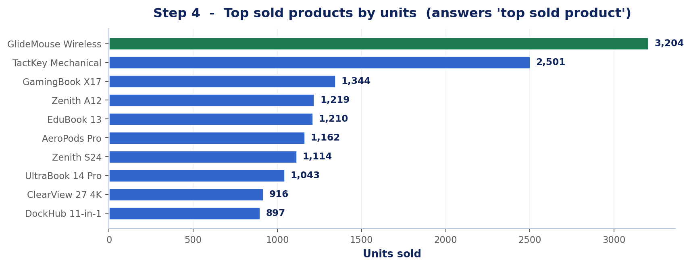
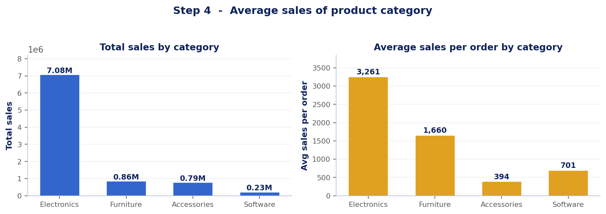
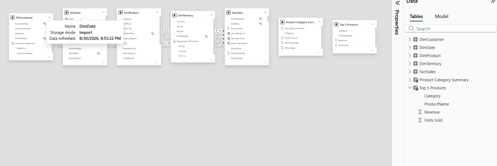
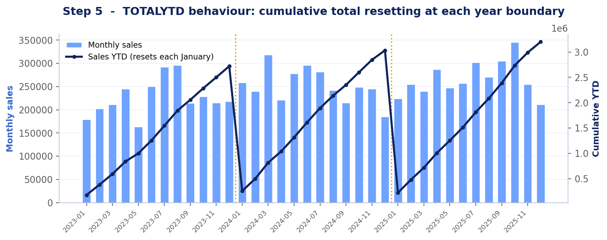
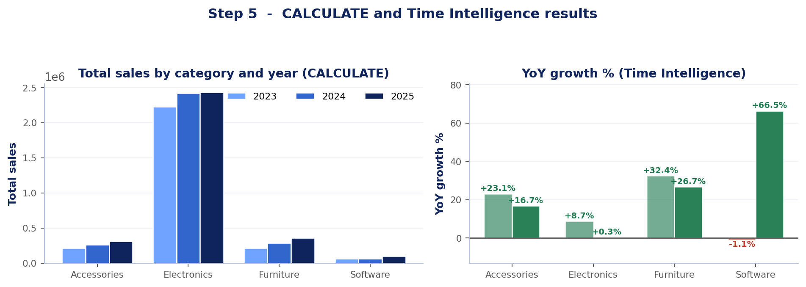
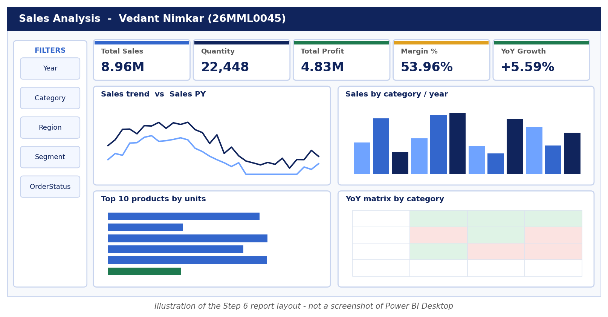
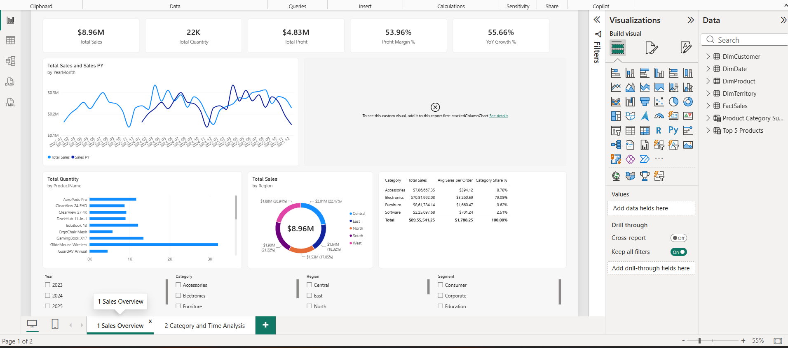
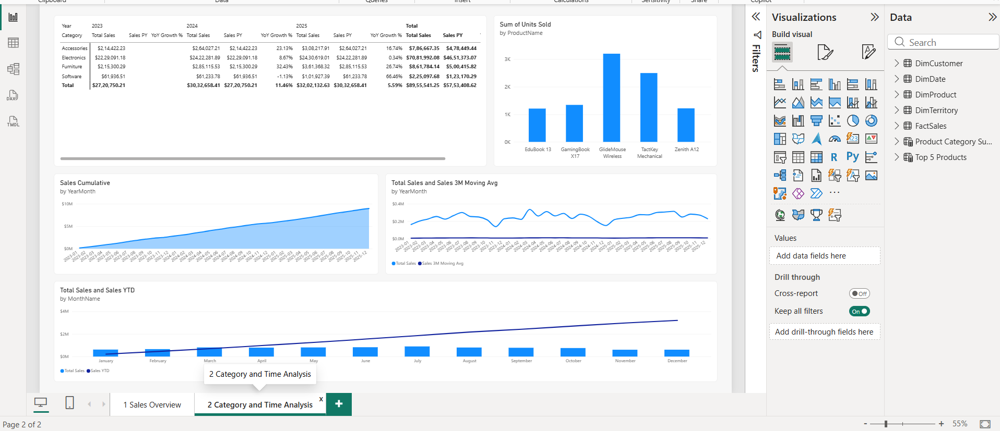

<div class='meta'>
<b>Name:</b> Vedant Nimkar &nbsp;|&nbsp; <b>Registration No.:</b> 26MML0045 &nbsp;|&nbsp; <b>Subject:</b> Visual Analytics Lab (MACSE603)<br>
<b>Assessment 2 covers:</b> calculated tables, columns and measures in DAX; advanced DAX with <code>CALCULATE()</code> and Time Intelligence; report design and publishing.
</div>

## Aim

4. Create calculated tables, calculated columns and measures using Data Analysis Expressions, to answer questions such as the top sold product and the average sales of a product category.
5. Use the `CALCULATE()` function to manipulate filter context, and use Time Intelligence functions on the sales data — for example total sales revenue for each product category and the year-over-year growth trend of a product category.
6. Design a report with the sales data and publish it with basic visualizations.

## Prerequisite

Assessment 1 must be complete: the cleansed `FactSales` table of 5,013 rows loaded, the star schema built with four active relationships, and `DimDate` marked as a date table. Time Intelligence functions in Step 5 return silently incorrect results if the date table is not marked.

---

# Step 4 — Calculated Tables, Columns and Measures

## 4.1 Calculated columns

Created via **Table tools → New column**. A calculated column is evaluated row by row at refresh time and stored in the model.

```
Net Unit Price = DIVIDE ( FactSales[SalesAmount], FactSales[OrderQuantity] )

Line Margin % =
DIVIDE ( FactSales[SalesAmount] - FactSales[TotalCost],
         FactSales[SalesAmount] )

Order Size Band =
SWITCH ( TRUE (),
    FactSales[OrderQuantity] <= 2, "1-2 units",
    FactSales[OrderQuantity] <= 4, "3-4 units",
    FactSales[OrderQuantity] <= 6, "5-6 units",
    "7+ units" )

Product Category = RELATED ( DimProduct[Category] )

Price Tier =
SWITCH ( TRUE (),
    DimProduct[ListPrice] < 100, "Budget",
    DimProduct[ListPrice] < 500, "Mid-range",
    "Premium" )

Financial Year =
"FY " & IF ( DimDate[MonthNo] >= 4, DimDate[Year], DimDate[Year] - 1 )
      & "-" & RIGHT ( IF ( DimDate[MonthNo] >= 4,
                           DimDate[Year] + 1, DimDate[Year] ), 2 )
```


## 4.2 Core measures

Created via **Table tools → New measure**. A measure is evaluated at query time against the current filter context and is not stored.

```
Total Sales           = SUM ( FactSales[SalesAmount] )
Total Quantity        = SUM ( FactSales[OrderQuantity] )
Total Cost            = SUM ( FactSales[TotalCost] )
Total Profit          = [Total Sales] - [Total Cost]
Profit Margin %       = DIVIDE ( [Total Profit], [Total Sales] )
Order Count           = DISTINCTCOUNT ( FactSales[SalesOrderNumber] )
Average Order Value   = DIVIDE ( [Total Sales], [Order Count] )
Average Line Sales    = AVERAGE ( FactSales[SalesAmount] )
Average Selling Price = DIVIDE ( [Total Sales], [Total Quantity] )
Customer Count        = DISTINCTCOUNT ( FactSales[CustomerKey] )
```

### Observation — unfiltered model

| Measure | Value |
|---|---|
| Total Sales | 8,955,541.25 |
| Total Quantity | 22,448 |
| Total Cost | 4,123,542.00 |
| Total Profit | 4,831,999.25 |
| Profit Margin % | 53.96% |
| Order Count | 5,008 |
| Average Order Value | 1,788.25 |


## 4.3 Question 1 — top sold product

```
Top Product by Units =
VAR TopProduct =
    TOPN ( 1, ALL ( DimProduct[ProductName] ),
           CALCULATE ( [Total Quantity] ), DESC )
RETURN CONCATENATEX ( TopProduct, DimProduct[ProductName], ", " )

Top Product Units =
MAXX ( ALL ( DimProduct[ProductName] ), CALCULATE ( [Total Quantity] ) )

Top Product by Revenue =
VAR TopProduct =
    TOPN ( 1, ALL ( DimProduct[ProductName] ),
           CALCULATE ( [Total Sales] ), DESC )
RETURN CONCATENATEX ( TopProduct, DimProduct[ProductName], ", " )

Product Rank by Units =
RANKX ( ALL ( DimProduct[ProductName] ), [Total Quantity], , DESC, DENSE )
```

`ALL()` is required inside `TOPN` so that the ranking is evaluated across every product rather than only the product on the current row.

### Observation

| Product | Units sold | Revenue |
|---|---|---|
| **GlideMouse Wireless** | **3,204** | 141,847.22 |
| TactKey Mechanical | 2,501 | 249,113.16 |
| GamingBook X17 | 1,344 | **2,534,432.17** |
| Zenith A12 | 1,219 | 383,030.70 |
| EduBook 13 | 1,210 | 746,661.45 |

The two rankings disagree, which is the analytically interesting result. `GlideMouse Wireless` leads on volume at 3,204 units but contributes only 141,847.22 in revenue, whereas `GamingBook X17` sells 58% fewer units yet generates almost eighteen times the revenue. A dashboard that reported only unit volume would misdirect attention entirely.


<figure>

<figcaption><b>Figure 1.</b> Top ten products by units sold, with the leading product highlighted.</figcaption>
</figure>


## 4.4 Question 2 — average sales of product category

```
Avg Sales per Line = AVERAGE ( FactSales[SalesAmount] )

Avg Sales per Order =
DIVIDE ( [Total Sales], DISTINCTCOUNT ( FactSales[SalesOrderNumber] ) )

Avg Sales per Category =
AVERAGEX ( VALUES ( DimProduct[Category] ), [Total Sales] )

Category Share % =
DIVIDE ( [Total Sales], CALCULATE ( [Total Sales], ALL ( DimProduct ) ) )
```

### Observation

| Category | Total Sales | Orders | Units | Avg Sales per Order | Share % |
|---|---|---|---|---|---|
| Electronics | 7,081,992.08 | 2,172 | 9,758 | 3,260.59 | 79.08% |
| Furniture | 861,784.14 | 519 | 2,422 | 1,660.47 | 9.62% |
| Accessories | 786,667.35 | 1,996 | 8,818 | 394.12 | 8.78% |
| Software | 225,097.68 | 321 | 1,450 | 701.24 | 2.51% |

`Avg Sales per Category` across all four categories = **2,238,885.31**.

Accessories ranks second on order count (1,996, almost matching Electronics at 2,172) yet last but one on total sales, because its average order value is 394.12 against Electronics at 3,260.59 — roughly eight times lower. High transaction volume is therefore not a proxy for revenue contribution.


<figure>

<figcaption><b>Figure 2.</b> Total sales and average sales per order by category, showing that order count and order value rank the categories differently.</figcaption>
</figure>


## 4.5 Calculated tables

Created via **Modeling → New table**. A calculated table is materialised at refresh.

```
Product Category Summary =
SUMMARIZE ( FactSales, DimProduct[Category],
    "Total Sales",         [Total Sales],
    "Total Quantity",      [Total Quantity],
    "Order Count",         [Order Count],
    "Avg Sales per Order", [Avg Sales per Order],
    "Total Profit",        [Total Profit],
    "Profit Margin %",     [Profit Margin %] )

Top 5 Products =
TOPN ( 5,
    SUMMARIZE ( FactSales, DimProduct[ProductName], DimProduct[Category],
        "Units Sold", [Total Quantity], "Revenue", [Total Sales] ),
    [Units Sold], DESC )

Date Table DAX =
ADDCOLUMNS ( CALENDAR ( DATE(2023,1,1), DATE(2025,12,31) ),
    "Year",      YEAR ( [Date] ),
    "MonthNo",   MONTH ( [Date] ),
    "MonthName", FORMAT ( [Date], "MMMM" ),
    "Quarter",   "Q" & QUARTER ( [Date] ),
    "YearMonth", FORMAT ( [Date], "YYYY-MM" ) )

Category Year Performance =
SUMMARIZE ( FactSales, DimProduct[Category], DimDate[Year],
            "Sales", [Total Sales] )

Discount Scenario = GENERATESERIES ( 0, 0.25, 0.05 )
```

`Product Category Summary` returns exactly four rows matching the table in section 4.4.


<figure class="sc">

<figcaption><b>Screenshot 1.</b> Product Category Summary calculated table in Data view</figcaption>
</figure>


---

# Step 5 — Advanced DAX: CALCULATE and Time Intelligence

## 5.1 Manipulating filter context with CALCULATE()

`CALCULATE` evaluates an expression under a modified filter context. It is the only DAX function that can change filter context.

| Technique | Function | Effect on context |
|---|---|---|
| Add a filter | `Category = "Electronics"` | narrows the context |
| Remove all filters | `ALL(DimProduct)` | grand-total denominator |
| Keep one filter | `ALLEXCEPT(DimProduct, Category)` | share within own category |
| Respect slicers | `ALLSELECTED(Category)` | share of user selection |
| Intersect, not replace | `KEEPFILTERS(Year = 2025)` | preserves an existing Year slicer |
| Switch relationship | `USERELATIONSHIP(...)` | activates the inactive path from Assessment 1 |

```
Electronics Sales =
CALCULATE ( [Total Sales], DimProduct[Category] = "Electronics" )

Pct of Total Sales =
DIVIDE ( [Total Sales],
         CALCULATE ( [Total Sales], ALL ( DimProduct ),
                                    ALL ( DimTerritory ) ) )

Pct of Category Sales =
DIVIDE ( [Total Sales],
         CALCULATE ( [Total Sales],
                     ALLEXCEPT ( DimProduct, DimProduct[Category] ) ) )

Sales 2025 Override    = CALCULATE ( [Total Sales], DimDate[Year] = 2025 )
Sales 2025 KeepFilters =
CALCULATE ( [Total Sales], KEEPFILTERS ( DimDate[Year] = 2025 ) )

Laptops or Mobiles Sales =
CALCULATE ( [Total Sales],
    FILTER ( ALL ( DimProduct[Subcategory] ),
             DimProduct[Subcategory] = "Laptops"
          || DimProduct[Subcategory] = "Mobiles" ) )

Sales by Customer Territory =
CALCULATE ( [Total Sales],
    USERELATIONSHIP ( DimCustomer[TerritoryKey],
                      DimTerritory[TerritoryKey] ) )
```

`Sales 2025 Override` and `Sales 2025 KeepFilters` differ materially: a direct predicate **replaces** any existing filter on that column, so with a Year slicer set to 2023 the override still returns 2025. `KEEPFILTERS` **intersects** instead, returning blank because 2023 and 2025 do not overlap.


## 5.2 Total sales revenue for each product category

```
Category Revenue =
CALCULATE ( [Total Sales], ALLEXCEPT ( DimProduct, DimProduct[Category] ) )

Category Revenue Table =
SUMMARIZE ( FactSales, DimProduct[Category], "Revenue", [Total Sales] )
```

| Category | 2023 | 2024 | 2025 | Total |
|---|---|---|---|---|
| Electronics | 2,229,091.18 | 2,422,281.89 | 2,430,619.01 | 7,081,992.08 |
| Furniture | 215,300.29 | 285,115.53 | 361,368.32 | 861,784.14 |
| Accessories | 214,422.23 | 264,027.21 | 308,217.91 | 786,667.35 |
| Software | 61,936.51 | 61,233.78 | 101,927.39 | 225,097.68 |
| **Total** | **2,720,750.21** | **3,032,658.41** | **3,202,132.63** | **8,955,541.25** |

## 5.3 Time Intelligence

```
Sales YTD = TOTALYTD ( [Total Sales], DimDate[Date] )
Sales QTD = TOTALQTD ( [Total Sales], DimDate[Date] )
Sales MTD = TOTALMTD ( [Total Sales], DimDate[Date] )

-- Indian financial year, April start
Sales FYTD = TOTALYTD ( [Total Sales], DimDate[Date], "31/03" )

Sales PY = CALCULATE ( [Total Sales], SAMEPERIODLASTYEAR ( DimDate[Date] ) )
Sales PM = CALCULATE ( [Total Sales], DATEADD ( DimDate[Date], -1, MONTH ) )

Sales Rolling 3M =
CALCULATE ( [Total Sales],
    DATESINPERIOD ( DimDate[Date], MAX ( DimDate[Date] ), -3, MONTH ) )

Sales Cumulative =
CALCULATE ( [Total Sales],
    FILTER ( ALLSELECTED ( DimDate[Date] ),
             DimDate[Date] <= MAX ( DimDate[Date] ) ) )

Sales 3M Moving Avg =
AVERAGEX (
    DATESINPERIOD ( DimDate[Date], MAX ( DimDate[Date] ), -3, MONTH ),
    CALCULATE ( [Total Sales] ) )
```


<figure>

<figcaption><b>Figure 3.</b> <code>TOTALYTD</code> behaviour. The cumulative line resets at each year boundary, confirming <code>DimDate</code> is correctly marked as a date table.</figcaption>
</figure>


## 5.4 Year-over-year growth trend of a product category

```
YoY Growth = 
VAR Cur = [Total Sales]
VAR Prev = [Sales PY]
RETURN IF ( NOT ISBLANK ( Prev ), Cur - Prev )

YoY Growth % = DIVIDE ( [Total Sales] - [Sales PY], [Sales PY] )

YoY Trend =
VAR G = [YoY Growth %]
RETURN SWITCH ( TRUE (),
    ISBLANK ( G ), "No prior year",
    G > 0.10,      "Strong growth",
    G > 0,         "Growing",
    G > -0.10,     "Slight decline",
    "Sharp decline" )

Electronics YoY % =
VAR Cur  = CALCULATE ( [Total Sales], DimProduct[Category] = "Electronics" )
VAR Prev = CALCULATE ( [Total Sales], DimProduct[Category] = "Electronics",
                       SAMEPERIODLASTYEAR ( DimDate[Date] ) )
RETURN DIVIDE ( Cur - Prev, Prev )
```

### Observation

| Category | 2024 vs 2023 | 2025 vs 2024 | Trend |
|---|---|---|---|
| Accessories | +23.13% | +16.74% | Strong growth |
| Electronics | +8.67% | +0.34% | Growing, now plateaued |
| Furniture | +32.43% | +26.74% | Strong growth |
| Software | −1.13% | +66.45% | Recovered sharply |
| **Overall** | **+11.46%** | **+5.59%** | Growing |

The headline figures conceal the important detail. Overall growth halved from +11.46% to +5.59%, and the cause is visible only at category level: Electronics, which is 79% of revenue, effectively stopped growing at +0.34%. Furniture and Accessories continued to grow strongly but are too small to compensate. Software reversed from −1.13% to +66.45%, though from a low base of 2.51% of revenue. This is precisely the divergence that Time Intelligence measures exist to surface.


<figure>

<figcaption><b>Figure 4.</b> Category revenue by year produced with <code>CALCULATE</code>, and year-over-year growth percentage produced with <code>SAMEPERIODLASTYEAR</code>.</figcaption>
</figure>


---

# Step 6 — Designing and Publishing the Report

## 6.1 Page 1 — Sales Overview

| Element | Visual type | Configuration |
|---|---|---|
| KPI row | Cards | Total Sales, Total Quantity, Total Profit, Profit Margin %, YoY Growth % |
| Sales trend | Line chart | Axis `Date Hierarchy`; values `[Total Sales]`, `[Sales PY]` |
| Category performance | Stacked column | Axis `Category`, legend `Year` |
| Top 10 products | Bar chart | Top-N filter 10 by `[Total Quantity]` |
| Regional split | Map or donut | Location `Region` |
| Category detail | Table | `Category`, `Subcategory`, `[Total Sales]`, `[Avg Sales per Order]`, `[Category Share %]` |
| Slicers | Year, Category, Region, Segment, OrderStatus | left panel |

## 6.2 Page 2 — Category and Time Analysis

| Element | Visual type | Configuration |
|---|---|---|
| YoY matrix | Matrix | Rows `Category`, columns `Year`, values `[Total Sales]`, `[Sales PY]`, `[YoY Growth %]` |
| Cumulative sales | Area chart | Axis `YearMonth`, value `[Sales Cumulative]` |
| Rolling average | Line chart | `[Total Sales]` vs `[Sales 3M Moving Avg]` |
| Monthly YTD | Line and clustered column | column `[Total Sales]`, line `[Sales YTD]` |
| Growth by subcategory | Bar chart | Axis `Subcategory`, value `[YoY Growth %]` |

Conditional formatting is applied to `[YoY Growth %]` on the matrix: green background above zero, red below.


<figure>

<figcaption><b>Figure 5.</b> Intended layout of the Page 1 report canvas. This is an illustration of the design, not a Power BI capture.</figcaption>
</figure>


<figure class="sc">

<figcaption><b>Screenshot 2.</b> Report Page 1 — Sales Overview in Power BI</figcaption>
</figure>


<figure class="sc">

<figcaption><b>Screenshot 3.</b> Report Page 2 — Category and Time Analysis in Power BI</figcaption>
</figure>


## 6.3 Formatting applied

| Setting | Value |
|---|---|
| Canvas | 16:9, background `#F7F9FC` |
| Accent colour | `#3366CC` throughout |
| Page title | `Sales Analysis — Vedant Nimkar (26MML0045)` |
| Drill-down | enabled via `Product Hierarchy` on category visuals |
| Interactions | slicers set to filter rather than highlight |
| Sort order | `[Total Sales]` descending on all category visuals |

## 6.4 Publishing procedure

1. **File → Save As** → `VisualAnalytics_Sales_26MML0045.pbix`
2. **Home → Publish**
3. Sign in with the institutional Microsoft 365 account
4. Select destination workspace → **My workspace**
5. On the *Success!* confirmation, follow the link to open the report in the browser

### Post-publish configuration

| Task | Location |
|---|---|
| Scheduled refresh | Workspace → Dataset → Settings → Scheduled refresh |
| Gateway connection | required only for the SQL Server source |
| Pin visuals to dashboard | hover a visual → Pin icon |
| Export | File → Export to PDF |


---

# Result

All three objectives of Assessment 2 were completed.

**Step 4.** Six calculated columns, ten core measures and five calculated tables were authored in DAX. `TOPN` with `ALL` identified `GlideMouse Wireless` as the top product by units at 3,204, while ranking by revenue returned `GamingBook X17` at 2,534,432.17 — demonstrating that volume and value produce different leaders. Category averages showed Accessories generating an average order value of 394.12 against Electronics at 3,260.59 despite comparable order counts.

**Step 5.** `CALCULATE` was used with `ALL`, `ALLEXCEPT`, `ALLSELECTED`, `KEEPFILTERS`, `FILTER` and `USERELATIONSHIP` to add, remove, retain and intersect filters and to activate the inactive relationship from Assessment 1. Time Intelligence functions produced year-to-date, prior-year, rolling three-month, cumulative and moving-average measures. Category year-over-year growth ranged from −1.13% to +66.45% against an overall +5.59%, revealing that Electronics had plateaued at +0.34% while contributing 79% of revenue.

**Step 6.** A two-page report was designed with KPI cards, trend, category, ranking and regional visuals, drill-down hierarchies, five slicers and a conditionally formatted year-over-year matrix, then published to the Power BI Service.

Every measure value was cross-checked against an independent pandas computation over the same source data, recorded in `expected_results/EXPECTED_RESULTS.txt`.

## Deliverables

| Path | Contents |
|---|---|
| `code/Step4_DAX_Calculated.txt` | calculated columns, measures, tables |
| `code/Step5_DAX_Advanced.txt` | CALCULATE and Time Intelligence |
| `code/Step6_Report_Design.md` | report layout and publish steps |
| `expected_results/` | verification values and derived tables |
| `figures/` | figures reproduced in this record |
| `screenshots/` | Power BI Desktop captures |

---

# Appendix — Complete Applied DAX

The listing below was extracted programmatically from the applied semantic model (`Visual1.SemanticModel/definition/tables/*.tmdl`). It is therefore the exact code running in the report, not a separately maintained transcription.

| Object type | Count |
|---|---|
| Tables | 7 |
| Calculated columns | 6 |
| Measures | 51 |
| Calculated tables | 2 |

## Calculated columns

### DimDate

```dax
Financial Year =
    "FY " & IF ( DimDate[MonthNo] >= 4, DimDate[Year],
                    DimDate[Year] - 1 )
           & "-" & RIGHT ( IF ( DimDate[MonthNo] >= 4,
                    DimDate[Year] + 1, DimDate[Year] ), 2 )

```

### DimProduct

```dax
Price Tier =
    SWITCH ( TRUE (),
        DimProduct[ListPrice] < 100, "Budget",
        DimProduct[ListPrice] < 500, "Mid-range",
        "Premium" )

```

### FactSales

```dax
Net Unit Price =
    DIVIDE ( FactSales[SalesAmount], FactSales[OrderQuantity] )

Line Margin % =
    DIVIDE ( FactSales[SalesAmount] - FactSales[TotalCost],
             FactSales[SalesAmount] )

Order Size Band =
    SWITCH ( TRUE (),
        FactSales[OrderQuantity] <= 2, "1-2 units",
        FactSales[OrderQuantity] <= 4, "3-4 units",
        FactSales[OrderQuantity] <= 6, "5-6 units",
        "7+ units" )

Product Category =
    RELATED ( DimProduct[Category] )

```

## Measures

### 01 Sales

```dax
Total Sales =
    SUM ( FactSales[SalesAmount] )

Total Quantity =
    SUM ( FactSales[OrderQuantity] )

Order Count =
    DISTINCTCOUNT ( FactSales[SalesOrderNumber] )

Average Order Value =
    DIVIDE ( [Total Sales], [Order Count] )

Average Line Sales =
    AVERAGE ( FactSales[SalesAmount] )

Average Selling Price =
    DIVIDE ( [Total Sales], [Total Quantity] )

Customer Count =
    DISTINCTCOUNT ( FactSales[CustomerKey] )

Product Count =
    DISTINCTCOUNT ( FactSales[ProductKey] )

```

### 02 Profit

```dax
Total Cost =
    SUM ( FactSales[TotalCost] )

Total Profit =
    [Total Sales] - [Total Cost]

Profit Margin % =
    DIVIDE ( [Total Profit], [Total Sales] )

```

### 03 Ranking

```dax
Top Product by Units =
    VAR TopProduct =
        TOPN ( 1, ALL ( DimProduct[ProductName] ),
               CALCULATE ( [Total Quantity] ), DESC )
    RETURN
        CONCATENATEX ( TopProduct, DimProduct[ProductName], ", " )

Top Product Units =
    MAXX ( ALL ( DimProduct[ProductName] ),
           CALCULATE ( [Total Quantity] ) )

Top Product by Revenue =
    VAR TopProduct =
        TOPN ( 1, ALL ( DimProduct[ProductName] ),
               CALCULATE ( [Total Sales] ), DESC )
    RETURN
        CONCATENATEX ( TopProduct, DimProduct[ProductName], ", " )

Product Rank by Units =
    RANKX ( ALL ( DimProduct[ProductName] ), [Total Quantity], ,
            DESC, DENSE )

```

### 04 Category

```dax
Avg Sales per Line =
    AVERAGE ( FactSales[SalesAmount] )

Avg Sales per Order =
    DIVIDE ( [Total Sales],
             DISTINCTCOUNT ( FactSales[SalesOrderNumber] ) )

Avg Sales per Category =
    AVERAGEX ( VALUES ( DimProduct[Category] ), [Total Sales] )

Category Share % =
    DIVIDE ( [Total Sales],
             CALCULATE ( [Total Sales], ALL ( DimProduct ) ) )

```

### 05 CALCULATE

```dax
Electronics Sales =
    CALCULATE ( [Total Sales], DimProduct[Category] = "Electronics" )

Shipped Sales =
    CALCULATE ( [Total Sales], FactSales[OrderStatus] = "Shipped" )

Discounted Sales =
    CALCULATE ( [Total Sales], FactSales[DiscountPct] > 0 )

Sales All Products =
    CALCULATE ( [Total Sales], ALL ( DimProduct ) )

Pct of Total Sales =
    DIVIDE ( [Total Sales],
             CALCULATE ( [Total Sales], ALL ( DimProduct ),
                                        ALL ( DimTerritory ) ) )

Category Revenue =
    CALCULATE ( [Total Sales],
                ALLEXCEPT ( DimProduct, DimProduct[Category] ) )

Pct of Category Sales =
    DIVIDE ( [Total Sales],
             CALCULATE ( [Total Sales],
                 ALLEXCEPT ( DimProduct, DimProduct[Category] ) ) )

Pct of Selected Sales =
    DIVIDE ( [Total Sales],
             CALCULATE ( [Total Sales],
                 ALLSELECTED ( DimProduct[Category] ) ) )

Sales 2025 Override =
    CALCULATE ( [Total Sales], DimDate[Year] = 2025 )

Sales 2025 KeepFilters =
    CALCULATE ( [Total Sales],
                KEEPFILTERS ( DimDate[Year] = 2025 ) )

Laptops or Mobiles Sales =
    CALCULATE ( [Total Sales],
        FILTER ( ALL ( DimProduct[Subcategory] ),
                 DimProduct[Subcategory] = "Laptops"
              || DimProduct[Subcategory] = "Mobiles" ) )

Sales by Customer Territory =
    CALCULATE ( [Total Sales],
        USERELATIONSHIP ( DimCustomer[TerritoryKey],
                          DimTerritory[TerritoryKey] ) )

```

### 06 Time

```dax
Sales YTD =
    TOTALYTD ( [Total Sales], DimDate[Date] )

Sales QTD =
    TOTALQTD ( [Total Sales], DimDate[Date] )

Sales MTD =
    TOTALMTD ( [Total Sales], DimDate[Date] )

Sales FYTD =
    TOTALYTD ( [Total Sales], DimDate[Date], "31/03" )

Sales PY =
    CALCULATE ( [Total Sales],
                SAMEPERIODLASTYEAR ( DimDate[Date] ) )

Sales PM =
    CALCULATE ( [Total Sales],
                DATEADD ( DimDate[Date], -1, MONTH ) )

Sales PQ =
    CALCULATE ( [Total Sales],
                DATEADD ( DimDate[Date], -1, QUARTER ) )

Sales PY YTD =
    CALCULATE ( [Sales YTD],
                SAMEPERIODLASTYEAR ( DimDate[Date] ) )

YoY Growth =
    VAR Cur = [Total Sales]
    VAR Prev = [Sales PY]
    RETURN
        IF ( NOT ISBLANK ( Prev ), Cur - Prev )

YoY Growth % =
    DIVIDE ( [Total Sales] - [Sales PY], [Sales PY] )

MoM Growth % =
    DIVIDE ( [Total Sales] - [Sales PM], [Sales PM] )

YoY Trend =
    VAR G = [YoY Growth %]
    RETURN
        SWITCH ( TRUE (),
            ISBLANK ( G ), "No prior year",
            G > 0.10,      "Strong growth",
            G > 0,         "Growing",
            G > -0.10,     "Slight decline",
            "Sharp decline" )

Sales Rolling 3M =
    CALCULATE ( [Total Sales],
        DATESINPERIOD ( DimDate[Date], MAX ( DimDate[Date] ),
                        -3, MONTH ) )

Sales Rolling 12M =
    CALCULATE ( [Total Sales],
        DATESINPERIOD ( DimDate[Date], MAX ( DimDate[Date] ),
                        -12, MONTH ) )

Sales Cumulative =
    CALCULATE ( [Total Sales],
        FILTER ( ALLSELECTED ( DimDate[Date] ),
                 DimDate[Date] <= MAX ( DimDate[Date] ) ) )

Sales 3M Moving Avg =
    AVERAGEX (
        DATESINPERIOD ( DimDate[Date], MAX ( DimDate[Date] ),
                        -3, MONTH ),
        CALCULATE ( [Total Sales] ) )

Category Revenue PY =
    CALCULATE ( [Total Sales],
        ALLEXCEPT ( DimProduct, DimProduct[Category] ),
        SAMEPERIODLASTYEAR ( DimDate[Date] ) )

Electronics YoY % =
    VAR Cur =
        CALCULATE ( [Total Sales],
                    DimProduct[Category] = "Electronics" )
    VAR Prev =
        CALCULATE ( [Total Sales],
                    DimProduct[Category] = "Electronics",
                    SAMEPERIODLASTYEAR ( DimDate[Date] ) )
    RETURN
        DIVIDE ( Cur - Prev, Prev )

Best Month Sales =
    MAXX ( VALUES ( DimDate[YearMonth] ),
           CALCULATE ( [Total Sales] ) )

Best Month Name =
    VAR T = TOPN ( 1, VALUES ( DimDate[YearMonth] ),
                   CALCULATE ( [Total Sales] ), DESC )
    RETURN
        CONCATENATEX ( T, DimDate[YearMonth], ", " )

```

## Calculated tables

### Product Category Summary

```dax
Product Category Summary =
    SUMMARIZE (
        FactSales,
        DimProduct[Category],
        "Total Sales",         [Total Sales],
        "Total Quantity",      [Total Quantity],
        "Order Count",         [Order Count],
        "Avg Sales per Order", [Avg Sales per Order]
    )
```

### Top 5 Products

```dax
Top 5 Products =
    TOPN (
        5,
        SUMMARIZE (
            FactSales,
            DimProduct[ProductName],
            DimProduct[Category],
            "Units Sold", [Total Quantity],
            "Revenue",    [Total Sales]
        ),
        [Units Sold], DESC
    )
```

## Relationships

| Name | From | To | Active |
|---|---|---|---|
| `rel_Date_Fact` | `FactSales.DateKey` | `DimDate.DateKey` | Yes |
| `rel_Product_Fact` | `FactSales.ProductKey` | `DimProduct.ProductKey` | Yes |
| `rel_Customer_Fact` | `FactSales.CustomerKey` | `DimCustomer.CustomerKey` | Yes |
| `rel_Territory_Fact` | `FactSales.TerritoryKey` | `DimTerritory.TerritoryKey` | Yes |
| `rel_Territory_Customer` | `DimCustomer.TerritoryKey` | `DimTerritory.TerritoryKey` | No |


<div class='note'><b>Figures and screenshots.</b> Figures 1 to 4 are rendered directly from the actual dataset and are therefore genuine results. Figure 5 is an illustration of the report layout. The 3 screenshots are Power BI Desktop captures from the working file. The DAX appendix was extracted from the applied semantic model, so it is verifiably the code running in the report.</div>