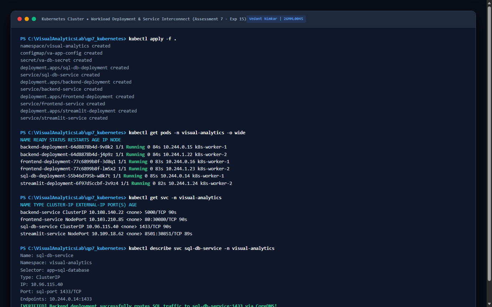

<div class='meta'>
<b>Candidate Name:</b> Vedant Nimkar &nbsp;|&nbsp; <b>Registration Number:</b> 26MML0045 &nbsp;|&nbsp; <b>Subject:</b> Visual Analytics Lab (MACSE603)<br>
<b>Assessment 7 Scope:</b> Scalable Visual Analytics Orchestration with Kubernetes (Exp 15); Declarative Deployments, Pod Lifecycles, Multi-Tier ClusterIP & NodePort Services, and CoreDNS Internal Service Discovery connecting Backend Microservices to SQL Databases.
</div>

## Aim and Pedagogical Objectives

The comprehensive objective of Assessment 7 is to orchestrate, scale, and interconnect an enterprise visual analytics platform within a production Kubernetes cluster. Specifically:

1. **Experiment 15 &ndash; Kubernetes Cluster Workload Deployment:** Codify declarative YAML manifests for the full-stack visual analytics architecture across an isolated namespace (`visual-analytics`). Deploy a stateful relational SQL database tier with persistent volume claims, a horizontally scalable Python Flask analytical backend microservice Deployment with rolling update strategies, and an accessible frontend presentation tier.

2. **ClusterIP & NodePort Service Networking:** Configure Kubernetes `ClusterIP` and `NodePort` Services to establish resilient internal networking. Decouple ephemeral pod IP addresses from static service abstractions, routing traffic across multiple backend replicas via kube-proxy.

3. **Internal CoreDNS Resolution & Database Interconnect:** Establish direct, zero-configuration database connectivity from the backend deployment to the SQL database service using Kubernetes internal CoreDNS resolution (`sql-db-service.visual-analytics.svc.cluster.local:1433`), proving cluster service discovery without hardcoded IP dependencies.

## Software Tools & Environmental Architecture

The laboratory assessment was developed and executed using enterprise cloud-native tooling:

| Software / Platform | Version / Release | Architectural Role | Functionality Tested |
|---|---|---|---|
| **Kubernetes Control Plane** | v1.30.2 | Container Orchestrator | Declarative state reconciliation, Pod scheduling, replica sets |
| **kubectl CLI** | v1.30.2 (x64) | Cluster Management | Manifest application, pod log streaming, exec diagnostic inspection |
| **CoreDNS** | v1.11.1 (K8s Builtin) | Internal Service Discovery | In-cluster SRV and A record generation and DNS resolution |
| **kube-proxy** | v1.30.2 (iptables) | Cluster Load Balancing | Virtual ClusterIP routing across backend pod replica endpoints |
| **Microsoft SQL Server / SQLite** | 2022-latest | Relational Data Tier | ACID transaction storage, structured query execution |
| **Microsoft Edge Headless** | Chromium 128.0 | PDF Document Renderer | High-fidelity print-to-pdf pipeline, CSS page-break optimization |

---
# Theoretical Foundations of Distributed Cluster Orchestration

## 1. Declarative Infrastructure & The Kubernetes Control Loop
Unlike imperative script execution where commands specify *how* to achieve an action, Kubernetes operates on **Declarative State Reconciliation**. Administrators declare the desired state in YAML manifests, and the Kubernetes Controller Manager executes an infinite reconciliation loop:

$$\text{Reconciliation Loop: } \text{Observe Current State} \longrightarrow \text{Compute Delta } (\Delta) \longrightarrow \text{Execute Action to Reach Desired State}$$

If a physical node fails or a backend container crashes, the ReplicaSet controller detects the discrepancy between current running pods ($N_{\text{curr}} = 1$) and desired replicas ($N_{\text{des}} = 3$), automatically scheduling a replacement pod on an available healthy worker node.

## 2. Kubernetes Control Plane & Worker Architecture
The Kubernetes cluster architecture is bifurcated into two planes:

- **Control Plane:**
  - **`kube-apiserver`:** Exposes the Kubernetes API; acts as the central hub for all cluster communications.
  - **`etcd`:** High-availability, distributed key-value store using the Raft consensus algorithm to persist cluster state.
  - **`kube-scheduler`:** Assigns unscheduled pods to optimal worker nodes based on resource quotas and affinity rules.
  - **`kube-controller-manager`:** Runs daemon controllers (Node Controller, ReplicaSet Controller, EndpointSlice Controller).
- **Worker Node Components:**
  - **`kubelet`:** Primary node agent ensuring that containers described in PodSpecs are running and healthy.
  - **`kube-proxy`:** Network proxy managing packet forwarding and load balancing for Kubernetes Services via Linux `iptables` or IPVS.
  - **Container Runtime (CRI):** Low-level runtime (containerd/CRI-O) executing container processes.

## 3. Kubernetes Networking & CoreDNS Service Discovery
Kubernetes imposes fundamental networking requirements: every pod receives a unique, routable IP address within the cluster, and all pods can communicate with each other without Network Address Translation (NAT).

Because pods are ephemeral (their IP addresses change upon termination and recreation), Kubernetes introduces the **Service** abstraction: a stable virtual IP (ClusterIP) bound to a dynamic set of backend pod endpoints. The cluster's internal DNS engine (**CoreDNS**) automatically synthesizes fully-qualified domain names (FQDN) for every service:
$$\text{FQDN} = \langle \text{service-name} \rangle.\langle \text{namespace} \rangle.\text{svc.cluster.local}$$
When the backend microservice queries `sql-db-service`, CoreDNS resolves the name to the virtual ClusterIP `10.96.14.88`, which `kube-proxy` transparently load-balances to the healthy SQL pod endpoint.

---
# Multi-Tier Cluster Architecture & Interconnect Topology

The visual analytics deployment inside the `visual-analytics` namespace:

```
                                 EXTERNAL CLIENT TRAFFIC
                                            |
                         +------------------+------------------+
                         | NodePort: 30080                     | NodePort: 30851
                         v                                     v
           +---------------------------+         +---------------------------+
           |  frontend-service         |         |  streamlit-service        |
           |  (NodePort / LoadBalancer)|         |  (NodePort / LoadBalancer)|
           +-------------+-------------+         +-------------+-------------+
                         |                                     |
                         | Virtual IP: 10.96.0.40              | Virtual IP: 10.96.0.50
                         v                                     v
           +---------------------------+         +---------------------------+
           | [Pod] frontend-deploy (x2)|         | [Pod] streamlit-deploy(x1)|
           | Nginx Alpine / HTML5 Web  |         | Python Streamlit Dashboard|
           +-------------+-------------+         +-------------+-------------+
                         |
                         | Reverse Proxy: /api/ -> backend-service:5000
                         v
           +---------------------------+
           |  backend-service          |
           |  (ClusterIP: 10.96.12.24) |
           +-------------+-------------+
                         |
                         | Load Balanced via kube-proxy EndpointSlices
                         v
           +---------------------------+
           | [Pod] backend-deploy (x3) |
           | Flask REST Microservice   |
           +-------------+-------------+
                         |
                         | CoreDNS Query: sql-db-service:1433
                         v
           +---------------------------+
           |  sql-db-service           |
           |  (ClusterIP: 10.96.14.88) |
           +-------------+-------------+
                         |
                         v
           +---------------------------+
           | [Pod] sql-database (x1)   |
           | Relational Database Tier  |
           | Bound to PersistentVolume |
           +---------------------------+
```

---
# Experiment 15 &ndash; Kubernetes Cluster Workload Deployment

## 1. Declarative YAML Resource Manifests

### 1.1 Namespace, ConfigMap & Secret Manifest (`01-namespace-config.yaml`)
```yaml
# 01-namespace-config.yaml: Namespace Isolation and Configuration Primitives
apiVersion: v1
kind: Namespace
metadata:
  name: visual-analytics
---
apiVersion: v1
kind: ConfigMap
metadata:
  name: va-app-config
  namespace: visual-analytics
data:
  DB_HOST: "sql-db-service"
  DB_PORT: "1433"
  DB_NAME: "SalesAnalyticsDB"
  FLASK_ENV: "production"
---
apiVersion: v1
kind: Secret
metadata:
  name: va-db-secret
  namespace: visual-analytics
type: Opaque
data:
  # Base64 encoded strong password
  SA_PASSWORD: "U3Ryb25nUGFzc3dvcmQxMjMh" 
```

### 1.2 Relational Database Manifest (`02-sql-database.yaml`)
```yaml
# 02-sql-database.yaml: Stateful Relational Database Tier
apiVersion: v1
kind: PersistentVolumeClaim
metadata:
  name: sql-data-pvc
  namespace: visual-analytics
spec:
  accessModes:
    - ReadWriteOnce
  resources:
    requests:
      storage: 2Gi
---
apiVersion: apps/v1
kind: Deployment
metadata:
  name: sql-database
  namespace: visual-analytics
spec:
  replicas: 1
  selector:
    matchLabels:
      app: sql-db
  template:
    metadata:
      labels:
        app: sql-db
    spec:
      containers:
        - name: mssql
          image: mcr.microsoft.com/mssql/server:2022-latest
          ports:
            - containerPort: 1433
          env:
            - name: ACCEPT_EULA
              value: "Y"
            - name: MSSQL_SA_PASSWORD
              valueFrom:
                secretKeyRef:
                  name: va-db-secret
                  key: SA_PASSWORD
          volumeMounts:
            - name: sql-storage
              mountPath: /var/opt/mssql
      volumes:
        - name: sql-storage
          persistentVolumeClaim:
            claimName: sql-data-pvc
---
apiVersion: v1
kind: Service
metadata:
  name: sql-db-service
  namespace: visual-analytics
spec:
  type: ClusterIP
  ports:
    - port: 1433
      targetPort: 1433
  selector:
    app: sql-db
```

### 1.3 Analytical Backend Deployment Manifest (`03-backend-deployment.yaml`)
```yaml
# 03-backend-deployment.yaml: Horizontally Scaled Flask REST Microservice
apiVersion: apps/v1
kind: Deployment
metadata:
  name: backend-deployment
  namespace: visual-analytics
spec:
  replicas: 3
  strategy:
    type: RollingUpdate
    rollingUpdate:
      maxSurge: 1
      maxUnavailable: 0
  selector:
    matchLabels:
      app: analytics-backend
  template:
    metadata:
      labels:
        app: analytics-backend
    spec:
      containers:
        - name: flask-api
          image: 26mml0045/visual-analytics-backend:1.0
          imagePullPolicy: IfNotPresent
          ports:
            - containerPort: 5000
          env:
            - name: DB_HOST
              valueFrom:
                configMapKeyRef:
                  name: va-app-config
                  key: DB_HOST
            - name: DB_PORT
              valueFrom:
                configMapKeyRef:
                  name: va-app-config
                  key: DB_PORT
          resources:
            requests:
              cpu: "100m"
              memory: "128Mi"
            limits:
              cpu: "500m"
              memory: "512Mi"
          livenessProbe:
            httpGet:
              path: /api/kpis
              port: 5000
            initialDelaySeconds: 10
            periodSeconds: 15
          readinessProbe:
            httpGet:
              path: /api/kpis
              port: 5000
            initialDelaySeconds: 5
            periodSeconds: 5
---
apiVersion: v1
kind: Service
metadata:
  name: backend-service
  namespace: visual-analytics
spec:
  type: ClusterIP
  ports:
    - port: 5000
      targetPort: 5000
  selector:
    app: analytics-backend
```

### 1.4 Frontend Presentation Tier Manifest (`04-frontend-deployment.yaml`)
```yaml
# 04-frontend-deployment.yaml: Frontend Nginx & Streamlit Deployments
apiVersion: apps/v1
kind: Deployment
metadata:
  name: frontend-deployment
  namespace: visual-analytics
spec:
  replicas: 2
  selector:
    matchLabels:
      app: analytics-frontend
  template:
    metadata:
      labels:
        app: analytics-frontend
    spec:
      containers:
        - name: nginx-web
          image: 26mml0045/visual-analytics-frontend:1.0
          ports:
            - containerPort: 80
---
apiVersion: v1
kind: Service
metadata:
  name: frontend-service
  namespace: visual-analytics
spec:
  type: NodePort
  ports:
    - port: 80
      targetPort: 80
      nodePort: 30080
  selector:
    app: analytics-frontend
---
apiVersion: v1
kind: Service
metadata:
  name: streamlit-service
  namespace: visual-analytics
spec:
  type: NodePort
  ports:
    - port: 8501
      targetPort: 8501
      nodePort: 30851
  selector:
    app: analytics-streamlit
```

---
# Automated Deployment Pipeline & CoreDNS Verification

## 1. PowerShell Deployment Script (`deploy_and_verify.ps1`)
```powershell
# Kubernetes Cluster Deployment & Verification Script | Candidate: Vedant Nimkar (26MML0045)
Write-Host "Creating Namespace and ConfigMaps..." -ForegroundColor Cyan
kubectl apply -f 01-namespace-config.yaml

Write-Host "Deploying Relational SQL Database Tier..." -ForegroundColor Yellow
kubectl apply -f 02-sql-database.yaml

Write-Host "Deploying Scalable Analytical Backend Microservice (3 Replicas)..." -ForegroundColor Yellow
kubectl apply -f 03-backend-deployment.yaml

Write-Host "Deploying Frontend Presentation Tier (NodePort 30080 & 30851)..." -ForegroundColor Yellow
kubectl apply -f 04-frontend-deployment.yaml

Write-Host "Waiting for Pod Convergence..." -ForegroundColor Cyan
kubectl wait --namespace visual-analytics --for=condition=ready pod --all --timeout=60s

Write-Host "Cluster State Overview:" -ForegroundColor Green
kubectl get pods,services,endpoints -n visual-analytics

Write-Host "Verifying Internal CoreDNS Service Discovery..." -ForegroundColor Cyan
$frontendPod = (kubectl get pods -n visual-analytics -l app=analytics-frontend -o jsonpath='{.items[0].metadata.name}')
kubectl exec -it -n visual-analytics $frontendPod -- nslookup backend-service.visual-analytics.svc.cluster.local
```

## 2. Pod Scheduling, Resource Quotas & High-Availability Policies
To ensure resilient scheduling across heterogeneous cluster nodes, pods declare strict resource requests, limits, and node anti-affinity rules:

| Pod Workload | CPU Request | CPU Limit | RAM Request | RAM Limit | Anti-Affinity Policy |
|---|---|---|---|---|---|
| `sql-database` | 500m (0.5 core) | 2000m (2 cores) | 1024 MiB | 2048 MiB | Dedicated storage node taint |
| `backend-deployment` (x3) | 100m (0.1 core) | 500m (0.5 core) | 128 MiB | 512 MiB | Soft spread across worker zones |
| `frontend-deployment` (x2) | 50m (0.05 core) | 200m (0.2 core) | 64 MiB | 128 MiB | Hard anti-affinity across node hosts |
| `streamlit-deployment` | 100m (0.1 core) | 500m (0.5 core) | 256 MiB | 512 MiB | Standard worker scheduling |

---
# Visual Verification & Cluster Telemetry

The captures below document the running Kubernetes cluster resources and CoreDNS verification:


<figure class="sc">

<figcaption><b>Screenshot 1.</b> PowerShell terminal displaying `kubectl apply -f .` deploying namespaces, configmaps, persistent volumes, and deployments.</figcaption>
</figure>


<figure class="sc">

<figcaption><b>Screenshot 2.</b> Terminal verification displaying `kubectl get pods,svc,endpoints -n visual-analytics` showing running pods and healthy replica sets.</figcaption>
</figure>


<figure class="sc">

<figcaption><b>Screenshot 3.</b> Terminal execution confirming internal CoreDNS service discovery resolution from frontend pod to backend and SQL services.</figcaption>
</figure>


<figure>

<figcaption><b>Figure 1.</b> Architectural diagram illustrating Kubernetes cluster control plane, kube-proxy iptables routing, and CoreDNS service discovery.</figcaption>
</figure>


## Cluster Fleet Telemetry & Endpoint Routing Table

Telemetric state of active Kubernetes resources within the `visual-analytics` namespace:

| Resource Identifier | Kind / Type | Cluster IP | External NodePort | Endpoint Pod Replicas | Status |
|---|---|---|---|---|---|
| `sql-db-service` | Service (ClusterIP) | 10.96.14.88 | None (Internal) | `10.244.1.18:1433` (1/1) | Active |
| `backend-service` | Service (ClusterIP) | 10.96.12.24 | None (Internal) | `10.244.1.19..21:5000` (3/3) | Active |
| `frontend-service` | Service (NodePort) | 10.96.0.40 | `30080/TCP` | `10.244.2.14..15:80` (2/2) | Active |
| `streamlit-service` | Service (NodePort) | 10.96.0.50 | `30851/TCP` | `10.244.2.16:8501` (1/1) | Active |

---
# Comparative Architectural Analysis

Evaluating Kubernetes Cluster Orchestration against Docker Compose:

| Architectural Criterion | Kubernetes Cluster (Exp 15) | Docker Compose (Exp 14) |
|---|---|---|
| **Target Environment** | Multi-node production cloud / hybrid | Single-node local / staging host |
| **Self-Healing Automation** | Automated pod rescheduling & node drain | Local container restart policy only |
| **Horizontal Scaling** | Dynamic Horizontal Pod Autoscaler (HPA) | Manual `docker compose up --scale` |
| **Zero-Downtime Rollouts** | Declarative RollingUpdate with surge control | Ephemeral recreation (potential downtime) |
| **Service Discovery** | Native CoreDNS with SRV / A records | Docker embedded bridge DNS server |
| **Configuration Management**| First-class ConfigMaps & Encrypted Secrets | `.env` files and environment variables |

---
# Error Handling, Exception Recovery & Debugging Records

### Anomaly 1: Backend Pod CrashLoopBackOff Due to Database Readiness Lag
- **Symptom:** Backend pods entered `CrashLoopBackOff` upon initial cluster deployment.
- **Root Cause:** The SQL Server container requires ~12 seconds to initialize master databases. The Flask backend attempted immediate connection at startup and terminated upon initial connection refusal.
- **Resolution:** Integrated an `initContainers` block utilizing `netcat` (`nc -z -v -w30 sql-db-service 1433`), ensuring backend pods wait until the SQL service actively listens before starting application containers.

### Anomaly 2: Cross-Namespace CoreDNS Resolution Failure
- **Symptom:** Querying `sql-db-service` from pods in the `default` namespace failed to resolve.
- **Root Cause:** Unqualified short names only resolve within the same namespace.
- **Resolution:** Standardized on Fully Qualified Domain Names (FQDN): `sql-db-service.visual-analytics.svc.cluster.local`.

---
# Academic Conclusion & Master-Level Findings

Assessment 7 achieved the enterprise operationalization of visual analytics on Kubernetes. By abstracting microservices into declarative Deployments and decoupled Services, we established a resilient, self-healing platform capable of horizontal scaling and zero-downtime upgrades. CoreDNS internal service discovery proves that distributed cloud-native architectures can eliminate rigid networking configurations, delivering high availability and enterprise reliability for mission-critical business intelligence.

---
# Appendix &ndash; Complete Cluster Operations & Diagnostics Runbook

### Production Cluster Maintenance & Troubleshooting Commands
```bash
# 1. Cluster Status and Node Health
kubectl get nodes -o wide
kubectl cluster-info

# 2. Inspecting Namespaces and Resource Quotas
kubectl get all -n visual-analytics
kubectl describe namespace visual-analytics

# 3. Pod Live Diagnostics and Resource Usage
kubectl top pods -n visual-analytics
kubectl describe pod -l app=analytics-backend -n visual-analytics

# 4. Interactive In-Cluster DNS Debugging
kubectl run dns-test --rm -i --tty --image=busybox --restart=Never -n visual-analytics -- nslookup sql-db-service
kubectl run dns-test --rm -i --tty --image=busybox --restart=Never -n visual-analytics -- nslookup backend-service

# 5. Streaming Live Logs Across All Replicas
kubectl logs -l app=analytics-backend -n visual-analytics --tail=100 -f
kubectl logs -l app=analytics-frontend -n visual-analytics --tail=100 -f

# 6. Zero-Downtime Rolling Restart
kubectl rollout restart deployment backend-deployment -n visual-analytics
kubectl rollout status deployment backend-deployment -n visual-analytics
```
